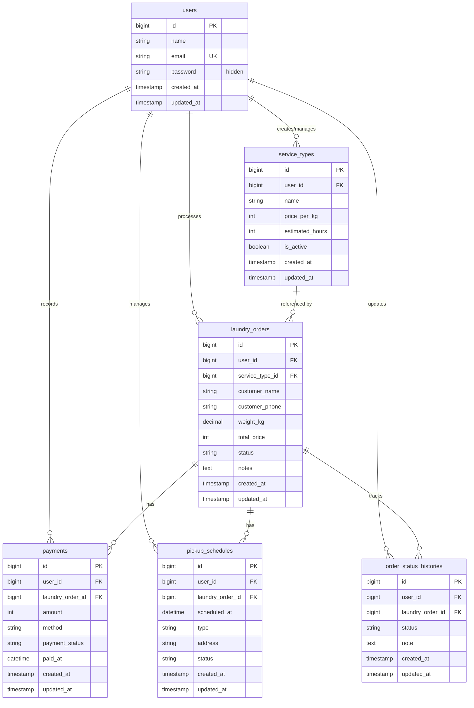

# WashPoint - REST API Sistem Manajemen Laundry

**Mata Kuliah:** CIE61207 - Teknologi dan Sistem Terintegrasi  
**Framework:** Laravel 12 (PHP 8.2+)  
**Arsitektur:** RESTful API Backend (JSON Response)  
**Database:** MySQL (`washpoint`)  

---

## 1. Pembagian Tugas Kelompok (5 Anggota)

| No | Anggota | Modul / Tabel Database | Tanggung Jawab & Fitur |
|:---:|:---|:---|:---|
| **1** | **Anggota 1** | `service_types` | Manajemen jenis paket laundry (harga per kg, estimasi waktu, status aktif). |
| **2** | **Anggota 2** | `laundry_orders` | Manajemen pesanan laundry pelanggan (nama, kontak, bobot kg, kalkulasi total harga, status order). |
| **3** | **Anggota 3** | `payments` | Manajemen pembayaran (metode cash/transfer/qris, status lunas/pending, waktu pelunasan). |
| **4** | **Anggota 4** | `pickup_schedules` | Manajemen jadwal penjemputan & pengantaran (waktu jadwal, tipe pickup/delivery, alamat penjemputan). |
| **5** | **Anggota 5** | `order_status_histories` | Manajemen riwayat log status pesanan (tracking progres pengerjaan cucian bertahap). |
| **-** | **Shared** | `users` | Autentikasi petugas / kasir / admin dan relasi foreign key ke seluruh tabel transaksi. |

---

## 2. Entity Relationship Diagram (ERD)



### Relasi Foreign Key:
1. `service_types.user_id` -> `users.id` (ON DELETE CASCADE)
2. `laundry_orders.user_id` -> `users.id` (ON DELETE CASCADE)
3. `laundry_orders.service_type_id` -> `service_types.id`
4. `payments.user_id` -> `users.id` (ON DELETE CASCADE)
5. `payments.laundry_order_id` -> `laundry_orders.id` (ON DELETE CASCADE)
6. `pickup_schedules.user_id` -> `users.id` (ON DELETE CASCADE)
7. `pickup_schedules.laundry_order_id` -> `laundry_orders.id` (ON DELETE CASCADE)
8. `order_status_histories.user_id` -> `users.id` (ON DELETE CASCADE)
9. `order_status_histories.laundry_order_id` -> `laundry_orders.id` (ON DELETE CASCADE)

---

## 3. Daftar Endpoint API (RESTful)

Base URL: `http://127.0.0.1:8000/api`

### Health Check
- `GET /api` - Cek konektivitas server & daftar modul API

### 1. Modul Users (`/api/users`)
- `GET /api/users` - Ambil semua user (password disembunyikan)
- `POST /api/users` - Tambah user baru (password di-hash)
- `GET /api/users/{id}` - Ambil detail user beserta relasi layanannya
- `PUT|PATCH /api/users/{id}` - Perbarui profil user
- `DELETE /api/users/{id}` - Hapus user

### 2. Modul Service Types - Anggota 1 (`/api/service-types`)
- `GET /api/service-types` - Ambil daftar jenis layanan (Eager loading `user`)
- `POST /api/service-types` - Tambah jenis layanan baru
- `GET /api/service-types/{id}` - Ambil detail layanan (Eager loading `user`, `laundryOrders`)
- `PUT|PATCH /api/service-types/{id}` - Perbarui data layanan
- `DELETE /api/service-types/{id}` - Hapus layanan

### 3. Modul Laundry Orders - Anggota 2 (`/api/laundry-orders`)
- `GET /api/laundry-orders` - Ambil daftar pesanan (Eager loading `user`, `serviceType`)
- `POST /api/laundry-orders` - Buat pesanan baru
- `GET /api/laundry-orders/{id}` - Detail pesanan (Eager loading `user`, `serviceType`, `payments`, `pickupSchedules`, `orderStatusHistories`)
- `PUT|PATCH /api/laundry-orders/{id}` - Perbarui data atau status pesanan
- `DELETE /api/laundry-orders/{id}` - Hapus pesanan

### 4. Modul Payments - Anggota 3 (`/api/payments`)
- `GET /api/payments` - Ambil riwayat pembayaran (Eager loading `user`, `laundryOrder`)
- `POST /api/payments` - Catat pembayaran baru
- `GET /api/payments/{id}` - Ambil detail pembayaran
- `PUT|PATCH /api/payments/{id}` - Perbarui data pembayaran
- `DELETE /api/payments/{id}` - Hapus catatan pembayaran

### 5. Modul Pickup Schedules - Anggota 4 (`/api/pickup-schedules`)
- `GET /api/pickup-schedules` - Ambil daftar jadwal pickup/delivery (Eager loading `user`, `laundryOrder`)
- `POST /api/pickup-schedules` - Buat jadwal penjemputan/pengantaran
- `GET /api/pickup-schedules/{id}` - Ambil detail jadwal penjemputan
- `PUT|PATCH /api/pickup-schedules/{id}` - Perbarui status/jadwal
- `DELETE /api/pickup-schedules/{id}` - Hapus jadwal

### 6. Modul Order Status Histories - Anggota 5 (`/api/order-status-histories`)
- `GET /api/order-status-histories` - Ambil riwayat status cucian (Eager loading `user`, `laundryOrder`)
- `POST /api/order-status-histories` - Tambah pencatatan status cucian (tracking)
- `GET /api/order-status-histories/{id}` - Ambil detail riwayat status
- `PUT|PATCH /api/order-status-histories/{id}` - Perbarui riwayat status
- `DELETE /api/order-status-histories/{id}` - Hapus log status

---

## 4. Contoh Request & Response Postman

Format Response JSON standar konsisten di seluruh endpoint:
```json
{
    "success": true,
    "message": "Pesan status",
    "data": { ... }
}
```

### A. Contoh Tambah Layanan (POST `/api/service-types`)
**Header:**
- `Content-Type: application/json`
- `Accept: application/json`

**Body:**
```json
{
    "user_id": 1,
    "name": "Cuci Kering Setrika Express",
    "price_per_kg": 10000,
    "estimated_hours": 12,
    "is_active": true
}
```
**Response (201 Created):**
```json
{
    "success": true,
    "message": "Jenis layanan berhasil ditambahkan",
    "data": {
        "id": 1,
        "user_id": 1,
        "name": "Cuci Kering Setrika Express",
        "price_per_kg": 10000,
        "estimated_hours": 12,
        "is_active": true,
        "created_at": "2026-11-02T15:57:00.000000Z",
        "updated_at": "2026-11-02T15:57:00.000000Z",
        "user": {
            "id": 1,
            "name": "Kasir Utama",
            "email": "kasir@washpoint.test",
            "created_at": "2026-11-02T15:56:00.000000Z",
            "updated_at": "2026-11-02T15:56:00.000000Z"
        }
    }
}
```
*(Catatan: password user otomatis tidak ditampilkan)*

### B. Contoh Buat Pesanan (POST `/api/laundry-orders`)
**Body:**
```json
{
    "user_id": 1,
    "service_type_id": 1,
    "customer_name": "Andi Pratama",
    "customer_phone": "081234567890",
    "weight_kg": 4.5,
    "total_price": 45000,
    "status": "received",
    "notes": "Pakaian dinas tolong disetrika licin"
}
```
**Response (201 Created):**
```json
{
    "success": true,
    "message": "Pesanan laundry berhasil dibuat",
    "data": {
        "id": 1,
        "user_id": 1,
        "service_type_id": 1,
        "customer_name": "Andi Pratama",
        "customer_phone": "081234567890",
        "weight_kg": "4.50",
        "total_price": 45000,
        "status": "received",
        "notes": "Pakaian dinas tolong disetrika licin",
        "created_at": "2026-11-02T15:58:00.000000Z",
        "updated_at": "2026-11-02T15:58:00.000000Z"
    }
}
```

### C. Contoh Respon Validasi Gagal (422 Unprocessable Content)
```json
{
    "success": false,
    "message": "Validasi gagal",
    "errors": {
        "name": [
            "The name field is required."
        ],
        "price_per_kg": [
            "The price per kg field is required."
        ]
    }
}
```

---

## 5. Cara Menjalankan & Menguji Proyek

### 1. Persiapan Environment
1. Salin `.env.example` menjadi `.env`:
   ```bash
   cp .env.example .env
   ```
2. Pastikan pengaturan database di `.env` sesuai MySQL lokal:
   ```env
   DB_CONNECTION=mysql
   DB_HOST=127.0.0.1
   DB_PORT=3306
   DB_DATABASE=washpoint
   DB_USERNAME=root
   DB_PASSWORD=
   ```
3. Install dependensi (jika baru di-clone tanpa folder vendor):
   ```bash
   composer install
   ```
4. Generate Application Key:
   ```bash
   php artisan key:generate
   ```
5. Jalankan Migration:
   ```bash
   php artisan migrate
   ```

### 2. Menjalankan Server API
Jalankan server lokal Laravel:
```bash
php artisan serve
```
Akses health-check di browser atau Postman: `http://127.0.0.1:8000/api`

### 3. Menguji Menggunakan Automated Test
Seluruh endpoint telah diuji dengan 10 skenario pengujian komprehensif:
```bash
php artisan test
```
Hasil pengujian: **12 passed (108 assertions)**.

### 4. Menguji dengan Postman
File Postman Collection sudah disertakan pada root project:
`WashPoint_API.postman_collection.json`
Tinggal buka Postman -> **Import** -> pilih file tersebut.

---

## 6. Format Pengumpulan Tugas

Sesuai instruksi tugas:
- Folder `vendor/` dan file `.env` **TIDAK** disertakan dalam arsip pengumpulan.
- File template `.env.example` sudah disertakan dengan konfigurasi standar database MySQL `washpoint`.
- Semua migrasi, model, controller, route, dan koleksi Postman sudah lengkap dan terverifikasi.
