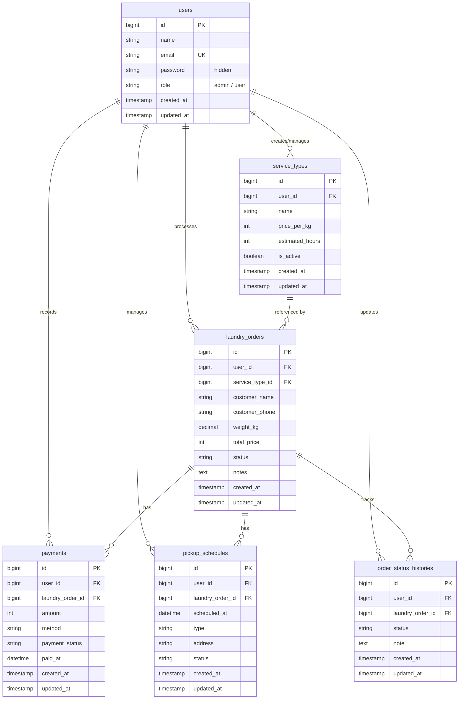

# WashPoint - REST API Sistem Manajemen Laundry

**Mata Kuliah:** CIE61207 - Teknologi dan Sistem Terintegrasi  
**Framework:** Laravel 12 (PHP 8.2+)  
**Keamanan:** Authentication (Sanctum) & Authorization Middleware (Role-Based CRU & CRUD)  
**Database:** MySQL (`washpoint`)  

---

## 1. Aturan Hak Akses (Authentication & Authorization Middleware)

Aplikasi mengimplementasikan middleware untuk memverifikasi autentikasi dan otorisasi:
- **Authentication Middleware (`auth:sanctum`)**: Semua endpoint resource laundry dan users diproteksi. Pengguna harus login terlebih dahulu dan menyertakan `Bearer Token` pada header request.
- **Authorization Middleware (`role.cru_crud`)**:
  - **Role `user`** memiliki hak akses **CRU** (*Create, Read, Update*). Jika role `user` mencoba mengirimkan request **DELETE**, middleware akan menolak dengan status **403 Forbidden**.
  - **Role `admin`** memiliki hak akses **CRUD** (*Create, Read, Update, Delete*) penuh.

---

## 2. Pembagian Tabel & Tugas Kelompok (5 Anggota)

Tabel `users` wajib ada sebagai induk autentikasi dan relasi, sedangkan tiap anggota meng-handle 1 tabel yang minimal terhubung ke tabel `users`:

| No | Anggota | Tabel Database | Relasi ke Users & Entitas Lain | Deskripsi Modul |
|:---:|:---|:---|:---|:---|
| **1** | **Anggota 1** | `service_types` | `user_id` -> `users.id` (FK) | Manajemen jenis paket laundry (harga/kg, estimasi jam, status aktif). |
| **2** | **Anggota 2** | `laundry_orders` | `user_id` -> `users.id` (FK)<br>`service_type_id` -> `service_types.id` (FK) | Manajemen pesanan laundry pelanggan (nama, telp, bobot, total harga, status order). |
| **3** | **Anggota 3** | `payments` | `user_id` -> `users.id` (FK)<br>`laundry_order_id` -> `laundry_orders.id` (FK) | Manajemen pembayaran (metode cash/transfer/qris, status lunas/pending, tanggal bayar). |
| **4** | **Anggota 4** | `pickup_schedules` | `user_id` -> `users.id` (FK)<br>`laundry_order_id` -> `laundry_orders.id` (FK) | Manajemen jadwal penjemputan & pengantaran (waktu jadwal, tipe pickup/delivery, alamat). |
| **5** | **Anggota 5** | `order_status_histories` | `user_id` -> `users.id` (FK)<br>`laundry_order_id` -> `laundry_orders.id` (FK) | Manajemen riwayat log status pengerjaan cucian bertahap. |
| **-** | **Shared** | `users` | Induk dari seluruh modul transaksi | Autentikasi token Sanctum, manajemen user & otorisasi role (`admin` / `user`). |

---

## 3. Entity Relationship Diagram (ERD)



---

## 4. Daftar Endpoint API (RESTful)

Base URL: `http://127.0.0.1:8000/api`

### A. Autentikasi (Public)
| Method | Endpoint | Deskripsi | Akses |
|:---|:---|:---|:---|
| `GET` | `/api` | Cek status server API & daftar endpoint | Publik |
| `POST` | `/api/register` | Mendaftarkan akun baru (role: `user` atau `admin`) | Publik |
| `POST` | `/api/login` | Login menggunakan email & password, mengembalikan token Sanctum | Publik |

### B. Profil & Logout (Protected - `auth:sanctum`)
| Method | Endpoint | Deskripsi | Akses |
|:---|:---|:---|:---|
| `GET` | `/api/me` | Melihat data profil user yang sedang login | User & Admin |
| `POST` | `/api/logout` | Menghapus token aktif saat ini | User & Admin |

### C. Resource Laundry & Users (Protected - `auth:sanctum` & `role.cru_crud`)
| Method | Endpoint Resource | Deskripsi | Izin Role |
|:---|:---|:---|:---|
| `GET` | `/api/{resource}` | Menampilkan daftar seluruh data (Eager Loading `with()`) | User & Admin (CRU/CRUD) |
| `POST` | `/api/{resource}` | Menambahkan data baru | User & Admin (CRU/CRUD) |
| `GET` | `/api/{resource}/{id}` | Menampilkan detail data berdasarkan ID | User & Admin (CRU/CRUD) |
| `PUT/PATCH` | `/api/{resource}/{id}` | Memperbarui data yang sudah ada | User & Admin (CRU/CRUD) |
| `DELETE` | `/api/{resource}/{id}` | Menghapus data | **HANYA Admin** (403 jika role `user`) |

*Daftar resource:*
1. `/api/service-types` (Anggota 1)
2. `/api/laundry-orders` (Anggota 2)
3. `/api/payments` (Anggota 3)
4. `/api/pickup-schedules` (Anggota 4)
5. `/api/order-status-histories` (Anggota 5)
6. `/api/users` (Shared)

---

## 5. Contoh Request & Response Postman

### Header Standar Protected Request:
```http
Authorization: Bearer <access_token>
Accept: application/json
Content-Type: application/json
```

### 1. Registrasi Akun (POST `/api/register`)
```json
{
    "name": "Budi Santoso",
    "email": "budi@washpoint.test",
    "password": "password123",
    "role": "user"
}
```
**Response (201 Created):**
```json
{
    "success": true,
    "message": "Registrasi berhasil",
    "data": {
        "user": {
            "id": 1,
            "name": "Budi Santoso",
            "email": "budi@washpoint.test",
            "role": "user",
            "created_at": "2026-11-23T06:17:00.000000Z",
            "updated_at": "2026-11-23T06:17:00.000000Z"
        },
        "access_token": "1|pZ9x...sanctum_token...",
        "token_type": "Bearer"
    }
}
```

### 2. Respon Penolakan DELETE jika Role `user` (403 Forbidden)
```json
{
    "success": false,
    "message": "Akses ditolak (Forbidden). Role 'user' hanya memiliki hak akses CRU (Create, Read, Update). Tindakan DELETE hanya dapat dilakukan oleh role 'admin'."
}
```

### 3. Respon DELETE Berhasil oleh Role `admin` (200 OK)
```json
{
    "success": true,
    "message": "Jenis layanan berhasil dihapus",
    "data": null
}
```

---

## 6. Pengujian Otomatis (Automated Testing)

Seluruh logika autentikasi, otorisasi CRU vs CRUD, dan endpoint 5 anggota telah diuji dengan test suite Laravel:
```bash
php artisan test
```
**Hasil:**
```text
PASS  Tests\Unit\ExampleTest
✓ that true is true

PASS  Tests\Feature\ExampleTest
✓ the application returns a successful response

PASS  Tests\Feature\WashPointApiTest
✓ api root endpoint returns success
✓ unauthenticated request is rejected
✓ authentication register and login
✓ service type cru by regular user
✓ laundry order cru by regular user
✓ payment cru by regular user
✓ pickup schedule cru by regular user
✓ order status history cru by regular user
✓ regular user cannot delete resource returns 403
✓ admin can delete resources crud success

Tests:    12 passed (53 assertions)
Duration: 3.88s
```

---

## 7. Panduan Menjalankan & Pengumpulan di BRONE

### Menjalankan di Lokal:
1. Pastikan MySQL aktif (Laragon / XAMPP) dan buat database `washpoint` (atau impor `database/sql/washpoint.sql`).
2. Install dependensi Composer:
   ```bash
   composer install
   ```
3. Jalankan migrasi & seeder database:
   ```bash
   php artisan migrate --seed
   ```
4. Jalankan server Laravel:
   ```bash
   php artisan serve
   ```
5. Cek detail kredensial testing (`admin` & `user`) dan daftar endpoint pada `INFO_KELOMPOK5.txt`, lalu uji di Postman (koleksi tersedia di `WashPoint_API.postman_collection.json`).

### Pengumpulan di BRONE (Format ZIP):
Sesuai instruksi pengumpulan Kelompok 5:
- Nama arsip: **`KELOMPOK5.zip`** (berisi projek Laravel dan `INFO_KELOMPOK5.txt`).
- File `.env` dan `.env.example` **DISERTAKAN**, sedangkan folder `vendor/` dan `node_modules/` **TIDAK** disertakan.
- Jalankan script `export_assignment.ps1` untuk otomatis membuat file `KELOMPOK5.zip` siap kumpul.
